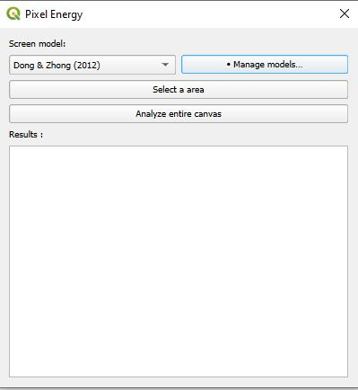
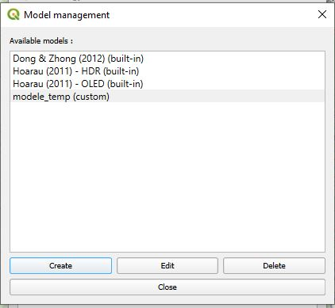
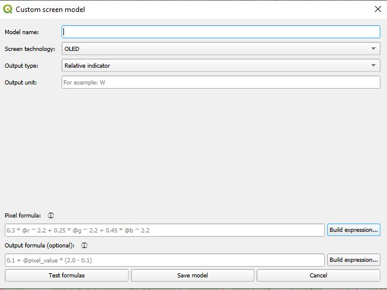
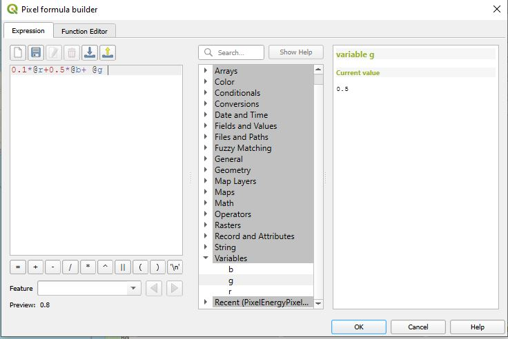
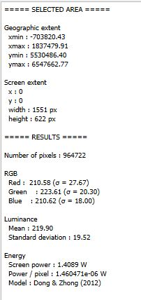

# Pixel Energy – User Guide

## 1. Main interface

The Pixel Energy main window provides access to the different analysis options and model settings.

It is divided into three main areas:

### Screen model selection

At the top of the window, the **Model** dropdown list allows you to select the screen model used for the analysis.

The **Manage models...** button opens the model manager, where you can create, edit, and delete custom models.

### Analysis options

Two analysis options are available:

- **Select an area**: allows you to draw a rectangular selection on the QGIS map canvas. Only the pixels within this area are analyzed.
- **Analyze the entire canvas**: analyzes all the pixels currently displayed in the QGIS map canvas.

### Results

The **Results** section displays the output of the analysis.

It includes information about the analyzed area, such as its geographic extent and pixel dimensions, followed by the calculated statistics and analysis results.

The results are displayed in a scrollable text area.

## 2. Model management

The **Model management** window provides access to the available screen models.

The **Available models** list displays both built-in models and custom models.

Four actions are available:

- **Create**: opens the model editor to create a new custom model.
- **Edit**: opens the selected custom model in the model editor.
- **Delete**: deletes the selected custom model.
- **Close**: closes the model management window.

Double-clicking a model in the list also opens it for editing.

Built-in models are provided by the plugin and cannot be edited or deleted. The Edit and Delete buttons are enabled only when a custom model is selected.

### 3. Creating and editing a custom model

The **Model editor** allows users to create a new custom model or modify an existing one.

The editor contains the following fields:

#### Model properties

- **Model name**: name assigned to the custom model.
- **Screen technology**: screen technology associated with the model (OLED, LCD, HDR or Other).
- **Output type**: defines the type of result produced by the model:
  - **Relative indicator**: produces a numerical indicator based on the pixel formula.
  - **Power**: estimates the total screen power consumption using a pixel formula and an output formula.
- **Output unit**: optional unit associated with the result (for example, W for watts).

#### Pixel formula

The pixel formula is applied to every pixel in the analyzed image.

Three variables are available:

- `@r`: normalized red component (between 0 and 1).
- `@g`: normalized green component (between 0 and 1).
- `@b`: normalized blue component (between 0 and 1).

Enter the formula directly or click **Build expression...** to open the expression builder.

#### Output formula

The output formula is optional and calculates the final result from the pixel-level value and image dimensions.

The following variables are available:

- `@pixel_value`: result of the pixel formula.
- `@pixel_count`: total number of analyzed pixels.
- `@width`: width of the analyzed image in pixels.
- `@height`: height of the analyzed image in pixels.

For models with the **Power** output type, the output formula is used to calculate the total estimated power consumption.

Enter the formula directly or click **Build expression...** to open the expression builder.

#### Available actions

- **Test formulas**: checks whether the formulas are valid and can be evaluated.
- **Save model**: saves the custom model.
- **Cancel**: closes the editor without saving the current changes.

### 4. Expression builders

Pixel Energy uses the QGIS Expression Builder to help users write formulas.

Two expression builders are available from the Model editor:

- **Pixel formula builder**: provides the variables used to calculate the contribution of each pixel.
- **Output formula builder**: provides the variables used to calculate the final result from the pixel-level value and the dimensions of the analyzed image.

Both builders use the QGIS Expression Engine, which provides access to its supported functions and operators.

During expression construction, sample values are assigned to the available variables to enable expression preview.

Click **OK** to transfer the expression to the corresponding field in the Model editor, or **Cancel** to close the builder without applying changes.

### 5. Analysis results

After an analysis, Pixel Energy displays the results in the **Results** section of the main window.

The results are organized into the following sections.

#### Selected area

This section describes the analyzed area using two types of information:

- **Geographic extent**: minimum and maximum X and Y coordinates (`xmin`, `xmax`, `ymin`, `ymax`).
- **Screen extent**: position of the analyzed area on the QGIS canvas (`x`, `y`) and its dimensions in pixels (`width`, `height`).

#### General statistics

This section provides information about the analyzed pixels:

- **Number of pixels**: total number of pixels included in the analysis.
- **RGB**: mean red, green and blue values, together with their standard deviations.
- **Luminance**: mean luminance and its standard deviation.

#### Model results

The displayed result depends on the output type of the selected model.

**Power models**

The following information is displayed:

- **Screen power**: estimated total screen power in watts (W).
- **Power / pixel**: estimated power contribution per pixel, with its associated unit.
- **Model**: name of the model used for the calculation.

**Relative indicator models**

The following information is displayed:

- **Indicator**: calculated indicator value.
- **Model**: name of the model used for the calculation.

All results are displayed as text in a scrollable area of the main window.

### 6. Built-in models

Pixel Energy includes three built-in models. They are provided as examples of different approaches to evaluating pixel content and estimating screen power consumption.

Built-in models cannot be edited or deleted through the Model management window.

#### 6.1. Dong & Zhong (2012)

**Screen technology:** OLED  
**Output type:** Power  
**Output unit:** W

Reference:

Dong, M. and Zhong, L. (2012). *Power Modeling and Optimization for OLED Displays.*

This model uses a weighted combination of the red, green and blue pixel components. Each component is raised to a power defined by the gamma parameter.

The pixel-level result is then used in an output formula to estimate total screen power consumption.

#### 6.2. Hoarau (2011) – HDR

**Screen technology:** HDR  
**Output type:** Relative indicator

Reference:

Hoarau, C. (2011). *Reaching a Compromise between Contextual Constraints and Cartographic Rules: Application to Sustainable Maps.*

This model uses the maximum value among the three normalized RGB components for each pixel:

`max(@r, @g, @b)`

The resulting indicator reflects the maximum RGB component of the analyzed pixels.

#### 6.3. Hoarau (2011) – OLED

**Screen technology:** OLED  
**Output type:** Relative indicator

Reference:

Hoarau, C. (2011). *Reaching a Compromise between Contextual Constraints and Cartographic Rules: Application to Sustainable Maps.*

This model calculates a pixel-level indicator by summing the three normalized RGB components:

`@r + @g + @b`

The resulting indicator reflects the sum of the RGB components of the analyzed pixels.

### 7. Limitations and interpretation

Pixel Energy analyzes the visual content displayed in the QGIS map canvas. Its calculations are based on the RGB values of the pixels included in the analysis.

The results therefore depend on the colors displayed in the analyzed area and their distribution.

Two types of outputs must be distinguished:

- **Relative indicators** provide numerical values based on the pixel formula defined by the selected model. They do not represent electrical power consumption.
- **Power estimates** provide an estimated screen power consumption in watts, based on the selected power model and its associated formulas.

The Dong & Zhong (2012) model uses predefined parameters for a specific OLED screen model. Its estimates should therefore be interpreted in the context of that screen model.

Pixel Energy provides an analytical approach to studying the relationship between map appearance and screen power consumption. Its results should not be interpreted as direct measurements of actual electrical consumption.